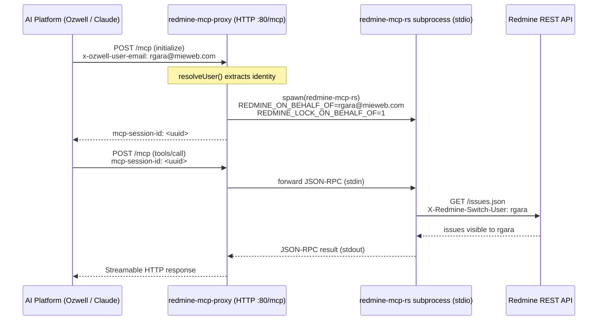

# redmine-mcp-proxy

A **Streamable HTTP → stdio bridge** that turns a stdio [Model Context
Protocol](https://modelcontextprotocol.io) Redmine server into a multi-user,
network-reachable MCP endpoint — with **per-user impersonation** baked in.

Point your AI platform (Ozwell, Claude, etc.) at a single URL:

```
https://rm.os.mieweb.org/mcp
```

…and every logged-in user transparently acts as **themselves** in Redmine — no
shared service account, no per-user API keys, no prompt-injectable identity.

---

## Why this exists

MCP Redmine servers speak **stdio** (one process, one identity). That's great
for a single desktop user, but it doesn't work when:

- Many people share one AI assistant, and each must act as **their own**
  Redmine user (correct "assigned to me", correct author, correct permissions).
- The MCP client is a hosted web platform that can only reach an **HTTP URL**,
  not a local subprocess.

This proxy solves both: it exposes **Streamable HTTP** on `/mcp`, and for every
session it spawns a **dedicated backend subprocess** locked to the requesting
user's identity.

---

## How the Proxy works



Step by step:

1. **Identity resolution.** On the first request of a session, `resolveUser(req)`
   determines *who* the caller is, in priority order:

   | Priority | Source                          | Sent by                       |
   | -------- | ------------------------------- | ----------------------------- |
   | 1        | `x-redmine-user` header         | Explicit override             |
   | 2        | `x-ozwell-user-email` header    | Ozwell AI platform (auto)     |
   | 3        | `x-ozwell-user-name` header     | Ozwell AI platform (auto)     |
   | 4        | `?user=` query parameter        | Manual / testing              |
   | 5        | Basic-auth username             | Clients that send credentials |

   No identity → **HTTP 401**. Nobody gets an anonymous or admin session by
   accident.

2. **Per-session subprocess.** A new session spawns one backend MCP process
   (the Rust [`redmine-mcp-rs`](https://github.com/mieweb/redmine-mcp-rs)
   binary) with the environment locked to that user:

   ```js
   env: {
     REDMINE_URL,
     REDMINE_API_KEY,                 // admin key, server-side only
     REDMINE_ON_BEHALF_OF: onBehalfOf, // the resolved user
     REDMINE_LOCK_ON_BEHALF_OF: "1",   // AI cannot override this
   }
   ```

   `REDMINE_LOCK_ON_BEHALF_OF=1` is the security keystone: even if the model is
   tricked ("act as the admin", "switch to user X"), the backend ignores any
   per-call identity and stays pinned to the header-derived user.

3. **Bidirectional bridge.** The proxy wires the two transports together:
   `StreamableHTTPServerTransport` (facing the AI) ⇄ `StdioClientTransport`
   (facing the subprocess). Messages are forwarded verbatim in both directions,
   so tool names and arguments pass through unchanged.

4. **Session tracking.** Each session is keyed by the `mcp-session-id` header.
   Subsequent requests reuse the same subprocess; closing either transport tears
   down the pair and frees the process.

5. **Impersonation on the wire.** The backend translates
   `REDMINE_ON_BEHALF_OF` into Redmine's `X-Redmine-Switch-User` header on every
   REST call, so Redmine enforces that user's real permissions and ownership.

---

## Configuration

Create `/opt/redmine-mcp-proxy/.env` (chmod `600` — it holds the admin key):

```sh
PORT=80
REDMINE_URL=https://pm.mieweb.com/
REDMINE_API_KEY=<redmine-admin-api-key>
```

| Variable          | Required | Description                                        |
| ----------------- | -------- | -------------------------------------------------- |
| `PORT`            | no       | Listen port (default `80`)                         |
| `REDMINE_URL`     | yes      | Redmine base URL                                   |
| `REDMINE_API_KEY` | yes      | **Admin** API key (needed for impersonation)       |

The path to the backend binary is set in `server.mjs` (the `command:` field of
the `StdioClientTransport`). Swap it for `node index.js` to use the Node
[`redmine-mcp`](https://github.com/mieweb/redmine-mcp) server instead of the
Rust one.

---

## Run

```sh
npm install
node server.mjs
```

### As a systemd service

`/etc/systemd/system/redmine-mcp-proxy.service`:

```ini
[Unit]
Description=Redmine MCP Streamable HTTP proxy
After=network.target

[Service]
Type=simple
User=pralambomanarivo
EnvironmentFile=/opt/redmine-mcp-proxy/.env
ExecStart=/usr/bin/node /opt/redmine-mcp-proxy/server.mjs
Restart=always
RestartSec=2

[Install]
WantedBy=multi-user.target
```

```sh
sudo systemctl enable --now redmine-mcp-proxy
```

> Binding to port 80 as a non-root user requires
> `sudo setcap cap_net_bind_service=+ep "$(command -v node)"`.

---

## Endpoints

| Method     | Path      | Purpose                                             |
| ---------- | --------- | --------------------------------------------------- |
| `GET`      | `/health` | `{ status, sessions, users }` liveness + who's on   |
| `POST/GET` | `/mcp`    | Streamable HTTP MCP endpoint                        |
| `DELETE`   | `/mcp`    | Terminate a session (`mcp-session-id` header)       |

```sh
curl -s https://rm.os.mieweb.org/health
# {"status":"ok","sessions":1,"users":["rgara@mieweb.com"]}
```

---

## Security model

- **Admin key never leaves the server.** The AI platform only sends a user
  identity header; the key lives in `.env` and is injected into the subprocess.
- **Locked impersonation.** `REDMINE_LOCK_ON_BEHALF_OF=1` makes identity
  header-driven and prompt-injection-proof.
- **Fail-closed.** No resolvable identity → `401`, never an anonymous/admin
  fallback.
- **Least privilege on the wire.** Redmine evaluates every request against the
  impersonated user's actual permissions.

---

## Related

- [`redmine-mcp-rs`](https://github.com/mieweb/redmine-mcp-rs) — the Rust MCP
  backend this proxy spawns (single static binary, fast startup).
- [`redmine-mcp`](https://github.com/mieweb/redmine-mcp) — the original Node MCP
  server (fully compatible backend).
